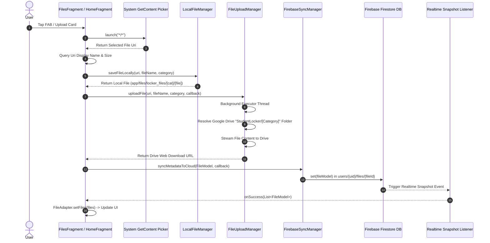
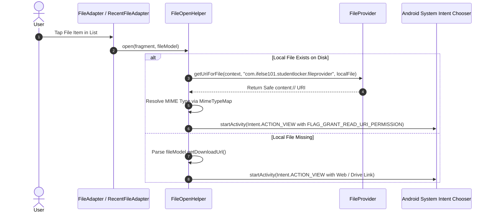
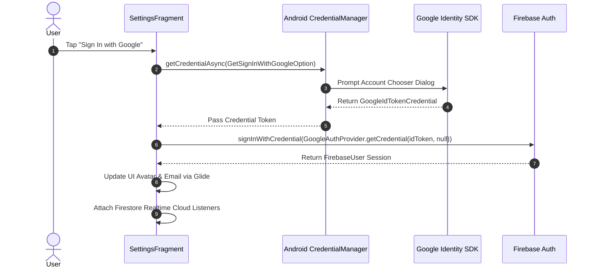

# 📚 Student Locker - Architecture & System Structure

**Student Locker** is a native Java Android application built with Material Design 3, Firebase Cloud Infrastructure, and Google Drive API. It allows students to manage, organize, and back up academic documents, notes, certificates, and files both offline and across cloud storage.

This document details the internal architecture, component responsibilities, data flow, and inter-component communication across the application.

---

## 🏛️ High-Level Architectural Pattern

Student Locker follows a modular architecture separating the **UI View Layer** (Activities, Fragments, ViewHolders), **Data Layer** (Local Persistence, Cloud Sync, Drive Uploads), **Domain Models**, and **System Integration Utilities**.

```
                           +-------------------------------------+
                           |            MainActivity             |
                           |    (BottomNavigationView Host)      |
                           +------------------+------------------+
                                              |
        +------------------+------------------+------------------+------------------+
        |                  |                  |                  |                  |
        v                  v                  v                  v                  v
+---------------+  +---------------+  +---------------+  +---------------+  +---------------+
| HomeFragment  |  | FilesFragment |  | FolderFragment|  | SearchFragment|  |SettingsFragment|
+-------+-------+  +-------+-------+  +-------+-------+  +-------+-------+  +-------+-------+
        |                  |                  |                  |                  |
        +------------------+------------------+------------------+                  |
                           |                                                        v
                           v                                              +-------------------+
                +---------------------+                                   | CredentialManager |
                | Realtime Sync &     |                                   |  & Firebase Auth  |
                | File Management     |                                   +-------------------+
                +----------+----------+
                           |
        +------------------+------------------+
        |                                     |
        v                                     v
+-----------------------+         +-----------------------+
|   LocalFileManager    |         |   FirebaseSyncManager |
| (App Internal Storage)|         |  (Firestore Cloud DB) |
+-----------------------+         +-----------+-----------+
                                              |
                                              v
                                  +-----------------------+
                                  |   FileUploadManager   |
                                  |   (Google Drive API)  |
                                  +-----------------------+
```

---

## 📂 System Package & Directory Structure

```text
StudentLocker/app/src/main/
├── java/com/ifelse101/studentlocker/
│   ├── StudentLockerApp.java             <-- Application entry point (Firebase initialization)
│   ├── MainActivity.java                 <-- Host Activity & Bottom Navigation Controller
│   ├── model/
│   │   ├── FileModel.java                <-- Document metadata entity (Firestore mapped)
│   │   └── FolderModel.java              <-- Folder metadata entity (Firestore mapped)
│   ├── data/
│   │   ├── local/
│   │   │   └── LocalFileManager.java     <-- Internal file system I/O & directory management
│   │   └── cloud/
│   │       ├── FileUploadManager.java    <-- Google Drive REST API background uploader
│   │       └── FirebaseSyncManager.java  <-- Firestore database CRUD & realtime listeners
│   ├── util/
│   │   └── FileOpenHelper.java           <-- FileProvider & Intent ACTION_VIEW opener
│   └── fragments/
│       ├── home/
│       │   ├── HomeFragment.java         <-- Storage dashboard, recent files & category list
│       │   ├── RecentFileAdapter.java    <-- ListAdapter for recent documents
│       │   ├── CategoryAdapter.java      <-- Horizontal ListAdapter for document categories
│       │   └── CategoryModel.java        <-- Category UI data model
│       ├── files/
│       │   ├── FilesFragment.java        <-- Document listing & file picker launcher
│       │   └── FileAdapter.java          <-- ListAdapter with DiffUtil for document items
│       ├── folder/
│       │   ├── FolderFragment.java       <-- Folder manager & folder document viewer
│       │   └── FolderAdapter.java        <-- ListAdapter for folder items with delete actions
│       ├── search/
│       │   └── SearchFragment.java       <-- Instant document search by query/category
│       └── settings/
│           ├── SettingsFragment.java     <-- Google Auth via Credential Manager & Profile UI
│           └── ThemeManager.java         <-- Light / Dark / System night mode manager
└── res/
    ├── layout/                           <-- XML Layout resource files for screens and item cards
    ├── menu/bottom_nav_menu.xml          <-- Navigation bar items configuration
    ├── xml/file_paths.xml                <-- FileProvider exposed paths mapping
    └── xml/preferences.xml               <-- App Settings preferences screen definition
```

---

## 🧩 Component Responsibilities & Inner Mechanics

### 1. Application Entry & Host Window
- **[StudentLockerApp.java](file:///C:/Users/User/AndroidStudioProjects/StudentLocker/app/src/main/java/com/ifelse101/studentlocker/StudentLockerApp.java)**: Subclasses `android.app.Application`. Initializes `FirebaseApp` on application boot before any Activity loads.
- **[MainActivity.java](file:///C:/Users/User/AndroidStudioProjects/StudentLocker/app/src/main/java/com/ifelse101/studentlocker/MainActivity.java)**: The single Activity hosting the UI.
  - Enables Android Edge-to-Edge display mode (`EdgeToEdge.enable(this)`).
  - Listens to system window insets (`ViewCompat.setOnApplyWindowInsetsListener`) to apply top system bar and bottom navigation bar padding.
  - Uses `ThemeManager.applyFromPreferences(this)` to enforce the saved night mode settings on launch.
  - Houses `BottomNavigationView` (`R.id.bottom_navigation`) and swaps fragment containers (`R.id.fragment_container`) using a functional factory map (`Map<Integer, Supplier<Fragment>>`).

### 2. Data Management & Synchronization Layer
- **[LocalFileManager.java](file:///C:/Users/User/AndroidStudioProjects/StudentLocker/app/src/main/java/com/ifelse101/studentlocker/data/local/LocalFileManager.java)**:
  - Manages private offline storage located at `context.getFilesDir()/locker_files/`.
  - Performs non-blocking byte stream copying from system `ContentResolver` `Uri` streams into local files using an 8KB buffer.
  - Handles local folder directory creation (`createLocalFolder`) and recursive deletion (`deleteLocalFolder`).
  - Provides offline availability checks (`isFileAvailableOffline`).
- **[FileUploadManager.java](file:///C:/Users/User/AndroidStudioProjects/StudentLocker/app/src/main/java/com/ifelse101/studentlocker/data/cloud/FileUploadManager.java)**:
  - Manages file uploads directly to the user's personal Google Drive storage using Google Drive API v3 ($0 developer server cost).
  - Runs tasks asynchronously on a dedicated `ExecutorService` single-thread executor and posts UI updates via `Handler(Looper.getMainLooper())`.
  - Authenticates with `GoogleAccountCredential.usingOAuth2(..., DriveScopes.DRIVE_FILE)` using the signed-in Firebase user's email.
  - Automatically queries and creates nested Drive folders: Root `StudentLocker/` -> Subfolder `[CategoryName]/` -> File.
  - Resolves Drive view links (`getWebViewLink()`, `getWebContentLink()`, or fallback file URL).
  - Handles `UserRecoverableAuthIOException` by prompting permission consent flow if Drive access was not yet granted.
- **[FirebaseSyncManager.java](file:///C:/Users/User/AndroidStudioProjects/StudentLocker/app/src/main/java/com/ifelse101/studentlocker/data/cloud/FirebaseSyncManager.java)**:
  - Interacts with Firebase Firestore for structured database storage.
  - Enforces per-user data isolation under the Firestore hierarchy: `users/{uid}/files/{fileId}` and `users/{uid}/folders/{folderId}`.
  - Provides real-time event listeners (`listenToCloudFiles`, `listenToFolders`) returning snapshot updates via `SyncListCallback` and `FolderListCallback`.
  - Sanitizes metadata before uploading (validates file existence and prevents orphan entries).

### 3. Data Entities
- **[FileModel.java](file:///C:/Users/User/AndroidStudioProjects/StudentLocker/app/src/main/java/com/ifelse101/studentlocker/model/FileModel.java)**:
  - Primary POJO representing document metadata synced to Firestore.
  - Fields: `fileId`, `fileName`, `localPath`, `downloadUrl`, `sizeBytes`, `mimeType`, `updatedAt`, `synced`, `category`.
  - Includes default empty constructor required by Firestore document deserialization (`document.toObject(FileModel.class)`).
- **[FolderModel.java](file:///C:/Users/User/AndroidStudioProjects/StudentLocker/app/src/main/java/com/ifelse101/studentlocker/model/FolderModel.java)**:
  - POJO for category folders.
  - Fields: `folderId`, `name`, `createdAt`, `documentCount`.

### 4. Presentation & Feature Fragments
- **[HomeFragment.java](file:///C:/Users/User/AndroidStudioProjects/StudentLocker/app/src/main/java/com/ifelse101/studentlocker/fragments/home/HomeFragment.java)**:
  - Dashboard displaying user avatar/name (Firebase Auth + Glide), real-time storage quota progress (calculated against 15 GB total limit), sync status, action cards ("Upload File", "New Category"), top 5 recent documents (`RecentFileAdapter`), and category list (`CategoryAdapter`).
  - Active category selection routes new file uploads into specific user folders.
- **[FilesFragment.java](file:///C:/Users/User/AndroidStudioProjects/StudentLocker/app/src/main/java/com/ifelse101/studentlocker/fragments/files/FilesFragment.java)**:
  - Document manager list rendered using `FileAdapter` (`ListAdapter` with `DiffUtil`).
  - Triggers system document picker via `ActivityResultContracts.GetContent()`.
  - Receives real-time cloud file updates via `FirebaseSyncManager.listenToCloudFiles()`.
- **[FolderFragment.java](file:///C:/Users/User/AndroidStudioProjects/StudentLocker/app/src/main/java/com/ifelse101/studentlocker/fragments/folder/FolderFragment.java)**:
  - Folder grid/list view managed via `FolderAdapter`.
  - Aggregates file counts dynamically across default `"General"` folder, Firestore cloud folders, and local file system subdirectories.
  - Includes dialog prompt (`MaterialAlertDialogBuilder`) for creating new folders and confirmation dialog for folder deletion.
- **[SearchFragment.java](file:///C:/Users/User/AndroidStudioProjects/StudentLocker/app/src/main/java/com/ifelse101/studentlocker/fragments/search/SearchFragment.java)**:
  - Real-time instant search interface.
  - Listens to Firestore cloud files and uses `TextWatcher` on `TextInputEditText` to filter files dynamically by file name or category name (case-insensitive).
- **[SettingsFragment.java](file:///C:/Users/User/AndroidStudioProjects/StudentLocker/app/src/main/java/com/ifelse101/studentlocker/fragments/settings/SettingsFragment.java)**:
  - Integrates AndroidX Credential Manager (`CredentialManager`) with `GetSignInWithGoogleOption` for Google Sign-In.
  - Exchanges Google ID Tokens with Firebase Auth (`GoogleAuthProvider.getCredential()`).
  - Hosts `SettingsPreferencesFragment` (`R.xml.preferences`) for theme management.

### 5. Utilities
- **[FileOpenHelper.java](file:///C:/Users/User/AndroidStudioProjects/StudentLocker/app/src/main/java/com/ifelse101/studentlocker/util/FileOpenHelper.java)**:
  - Resolves file opening requests.
  - Local First: Checks if `localPath` points to a valid file -> Obtains content URI via Android `FileProvider` (`com.ifelse101.studentlocker.fileprovider`) -> Resolves MIME type (`MimeTypeMap`) -> Launches `Intent.ACTION_VIEW` chooser with `FLAG_GRANT_READ_URI_PERMISSION`.
  - Remote Fallback: If local file does not exist, parses `downloadUrl` and opens default web viewer / Drive link.
- **[ThemeManager.java](file:///C:/Users/User/AndroidStudioProjects/StudentLocker/app/src/main/java/com/ifelse101/studentlocker/fragments/settings/ThemeManager.java)**:
  - Bridges AndroidX SharedPreferences preferences with `AppCompatDelegate.setDefaultNightMode()` supporting `system`, `light`, and `dark` modes.

---

## 🔄 How Components Communicate & Work Together

Below are the step-by-step operational workflows showing how data and signals flow between system components.

### Sequence 1: File Upload & Dual-Storage Sync Workflow



1. **User Action**: The user selects a document from system storage.
2. **Local Storage**: `LocalFileManager` immediately makes an offline copy in internal storage.
3. **Drive Streaming**: `FileUploadManager` streams the file to Google Drive asynchronously on a single-thread executor.
4. **Cloud Metadata Sync**: `FirebaseSyncManager` writes document metadata (local path, download link, category, size) to Firestore under `users/{uid}/files/{fileId}`.
5. **Real-Time UI Update**: Firestore snapshot listeners emit updated collections to `HomeFragment`, `FilesFragment`, `FolderFragment`, and `SearchFragment`, automatically re-rendering UI lists without manual refreshes.

---

### Sequence 2: File Viewing Workflow (Offline-First)



---

### Sequence 3: Authentication & Cloud Session Workflow



---

## 💾 Cloud Database Schema (Firestore)

Cloud metadata is stored in Firebase Firestore under per-user sandboxed document paths:

### Files Collection: `users/{uid}/files/{fileId}`
| Field Name | Type | Description |
| :--- | :--- | :--- |
| `fileId` | String | Unique document ID generated by Firestore |
| `fileName` | String | Original display name of the uploaded file |
| `localPath` | String | Absolute path to the file in app private internal storage |
| `downloadUrl` | String | Direct Google Drive web view/content link |
| `sizeBytes` | Number | File size in bytes |
| `mimeType` | String | MIME type string (e.g. `application/pdf`, `image/png`) |
| `updatedAt` | Number | Timestamp of last modification in epoch milliseconds |
| `synced` | Boolean | `true` if metadata is synced with Firestore |
| `category` | String | Folder category name (defaults to `"General"`) |

### Folders Collection: `users/{uid}/folders/{folderId}`
| Field Name | Type | Description |
| :--- | :--- | :--- |
| `folderId` | String | Unique folder ID generated by Firestore |
| `name` | String | Custom category / folder name created by user |
| `createdAt` | Number | Folder creation timestamp in epoch milliseconds |
| `documentCount` | Number | Number of documents assigned to this folder |

---

## ⚙️ Build System & Environment Dependencies

*(Minor Reference Section)*

### System Requirements
- **IDE**: Android Studio (Electric Eel 2022.1.1 or newer recommended)
- **JDK**: Java 17 (Source & Target compatibility configured to `JavaVersion.VERSION_17`)
- **Android SDK Target**: SDK 35 (`compileSdk = 35`, `targetSdk = 35`, `minSdk = 26`)
- **Build System**: Gradle 8.8.2 with Android Gradle Plugin (AGP) `8.8.2` and Google Services Plugin `4.5.0`

### Key Third-Party Libraries & Dependencies
| Library / Artifact | Version | Purpose |
| :--- | :--- | :--- |
| `com.google.firebase:firebase-bom` | `35.0.0` | Firebase Bill of Materials |
| `com.google.firebase:firebase-firestore` | via BOM | Realtime Cloud NoSQL Metadata Database |
| `com.google.firebase:firebase-auth` | via BOM | Firebase User Authentication |
| `com.google.android.libraries.identity.googleid:googleid` | `1.1.1` | Google ID Token Authentication |
| `androidx.credentials:credentials` | `1.3.0` | Android Credential Manager API |
| `com.google.apis:google-api-services-drive` | `v3-rev20230822-2.0.0` | Google Drive REST API Client |
| `com.google.api-client:google-api-client-android` | `2.2.0` | Google API Client for Android |
| `com.github.bumptech.glide:glide` | `4.16.0` | Asynchronous image loading & avatar caching |
| `com.google.android.material:material` | `1.10.0` | Material Design 3 UI components |
| `androidx.preference:preference` | `1.2.1` | Android Preferences screen framework |
